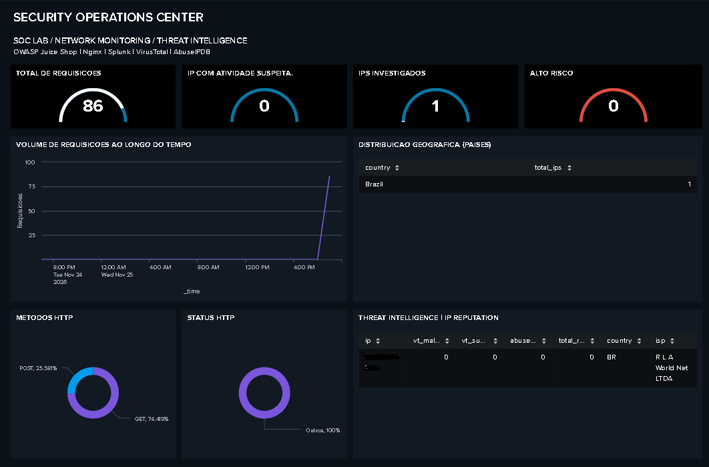

# SOC Lab — Security Operations Center


## Sobre o projeto

O SOC Lab é um laboratório prático desenvolvido para simular algumas das atividades realizadas em um Security Operations Center (SOC), com foco em monitoramento de eventos, centralização de logs, análise de requisições HTTP e enriquecimento de informações por meio de Threat Intelligence.

A proposta do projeto é construir um ambiente no qual seja possível gerar eventos a partir de uma aplicação web, coletar esses registros, encaminhá-los para uma plataforma SIEM e utilizar consultas e dashboards para visualizar e analisar as informações.

Como aplicação de laboratório, foi utilizada a OWASP Juice Shop, executada em um container Docker. O tráfego gerado durante a utilização da aplicação é registrado pelo Nginx em formato JSON e encaminhado ao Splunk Enterprise por meio de um script desenvolvido em Python.

Além da coleta de eventos, o laboratório possui uma integração automatizada com as plataformas VirusTotal e AbuseIPDB. Essa integração permite enriquecer informações sobre endereços IP públicos identificados nos acessos à aplicação, acrescentando indicadores de reputação aos eventos centralizados no Splunk.

O objetivo é aproximar o aprendizado de conceitos utilizados em operações de segurança, desde a geração e coleta de eventos até sua análise e visualização.

---

## Objetivos

O desenvolvimento do laboratório tem como objetivos:

- Implementar uma plataforma SIEM utilizando Splunk Enterprise.
- Construir um ambiente de coleta e centralização de logs.
- Monitorar requisições HTTP de uma aplicação web.
- Desenvolver scripts Python para automação e integração de eventos.
- Integrar fontes externas de Threat Intelligence.
- Realizar enriquecimento de informações sobre IPs públicos.
- Utilizar SQLite para armazenar resultados e evitar consultas repetidas.
- Desenvolver pesquisas SPL para análise dos eventos.
- Criar dashboards para acompanhamento das informações coletadas.

---

## Arquitetura do laboratório

O ambiente foi construído utilizando duas máquinas virtuais Ubuntu Server, executadas no VirtualBox e conectadas por meio do Tailscale.

Cada máquina possui uma responsabilidade específica dentro da arquitetura.

### 1. Máquina SOC-LAB-Ubuntu — SIEM

Esta máquina executa o Splunk Enterprise, responsável por receber, centralizar, indexar e disponibilizar os eventos coletados pelo laboratório.

O Splunk recebe informações de duas fontes principais:

- Eventos HTTP gerados pelo Nginx.
- Eventos de enriquecimento de Threat Intelligence enviados pelos scripts Python.

O encaminhamento dos dados é realizado utilizando o HTTP Event Collector (HEC), permitindo que aplicações externas enviem eventos diretamente à plataforma.

### 2. Máquina juicelab — Aplicação e coleta

Esta máquina concentra os componentes responsáveis pela geração, coleta e processamento dos eventos.

**OWASP Juice Shop**

Aplicação web utilizada como ambiente de testes. Durante a navegação, são geradas requisições HTTP que permitem observar diferentes métodos, rotas acessadas, códigos de resposta e informações dos clientes.

**Docker**

Responsável por executar a aplicação Juice Shop em um container isolado.

**Nginx**

Atua como proxy reverso da aplicação e registra as requisições recebidas em arquivos de log estruturados em JSON.

Entre as informações registradas estão:

- Endereço IP encaminhado.
- Método HTTP.
- URI requisitada.
- Código de resposta.
- User-Agent.
- Tempo de processamento da requisição.

**Scripts Python**

Realizam o monitoramento dos arquivos de log, encaminhamento dos eventos ao Splunk e integração com as plataformas de Threat Intelligence.

---

## Fluxo de processamento dos eventos

O funcionamento do laboratório ocorre por meio de um fluxo integrado entre a aplicação, os mecanismos de coleta, os scripts Python e o SIEM.

1. Um usuário acessa a aplicação OWASP Juice Shop.
2. O Nginx recebe as requisições e registra os eventos em formato JSON.
3. O `forwarder.py` monitora o arquivo de log e encaminha novos registros ao Splunk utilizando HEC.
4. O `auto_threat_intel.py` monitora os acessos e identifica endereços IP públicos.
5. Quando um novo IP elegível é identificado, o processo verifica se já existe uma investigação válida no cache.
6. Caso não exista um resultado válido, o `threat_intel.py` consulta as APIs VirusTotal e AbuseIPDB.
7. Os resultados das consultas são consolidados e enviados ao Splunk.
8. O `ti_cache.py` armazena os resultados no banco SQLite, evitando consultas repetidas durante o período de validade de 24 horas.
9. Os eventos ficam disponíveis no Splunk para pesquisas SPL, análise e visualização nos dashboards.

### Visão simplificada da arquitetura

```text
              USUÁRIO
                 |
                 v
          OWASP JUICE SHOP
              (Docker)
                 |
                 v
               NGINX
          Logs em formato JSON
                 |
          +------+------+
          |             |
          v             v
     forwarder.py   auto_threat_intel.py
          |             |
          |             v
          |        threat_intel.py
          |             |
          |       +-----+------+
          |       |            |
          |       v            v
          |   VirusTotal   AbuseIPDB
          |       |            |
          |       +-----+------+
          |             |
          |          SQLite
          |          (Cache)
          |             |
          +------+------+
                 |
                 v
          SPLUNK ENTERPRISE
                 |
                 v
          CONSULTAS SPL
                 |
                 v
           DASHBOARDS SOC
```

---

## Integração de Threat Intelligence

Uma das funcionalidades implementadas no laboratório é o enriquecimento automatizado de endereços IP públicos por meio de duas plataformas externas.

### VirusTotal

A integração utiliza a API do VirusTotal para consultar informações de análise de endereços IP.

Entre os indicadores utilizados estão:

- Quantidade de detecções maliciosas.
- Quantidade de detecções inofensivas.
- Resultados não detectados.
- Classificações suspeitas.

### AbuseIPDB

A integração utiliza a API do AbuseIPDB para consultar informações relacionadas ao histórico de abuso de endereços IP.

Entre os dados retornados estão:

- Abuse Confidence Score.
- Quantidade de denúncias.
- Código do país.
- Provedor de Internet (ISP).

### Cache SQLite

Para evitar consultas repetidas às APIs, foi implementado um mecanismo de cache utilizando SQLite.

Os resultados são armazenados localmente por 24 horas. Quando um endereço IP já possui uma investigação válida, o sistema reutiliza os dados armazenados em vez de realizar novas consultas.

Esse mecanismo ajuda a reduzir chamadas desnecessárias às APIs e otimizar o processamento das investigações.

---

## Scripts desenvolvidos

Os scripts Python são responsáveis pela comunicação entre os componentes do laboratório.

| Script | Responsabilidade |
|---|---|
| `forwarder.py` | Monitora os logs do Nginx e encaminha novos eventos HTTP ao Splunk via HEC. |
| `auto_threat_intel.py` | Monitora os acessos e identifica automaticamente IPs públicos para enriquecimento. |
| `threat_intel.py` | Consulta VirusTotal e AbuseIPDB, consolida os resultados e envia os eventos ao Splunk. |
| `ti_cache.py` | Gerencia o armazenamento e a validade dos resultados no SQLite. |

Os códigos e suas explicações estão disponíveis na pasta [`scripts/`](scripts/).

---

## Monitoramento e análise no Splunk

O Splunk Enterprise funciona como o ponto central de análise do laboratório.

Os eventos recebidos são utilizados em pesquisas SPL e visualizações no Dashboard Studio.

As análises desenvolvidas incluem:

- Monitoramento de requisições HTTP.
- Volume de acessos registrados.
- Distribuição dos métodos HTTP.
- Análise dos códigos de resposta.
- Identificação de endereços IP de origem.
- Visualização geográfica de IPs investigados.
- Indicadores de reputação do VirusTotal.
- Indicadores de abuso do AbuseIPDB.

As consultas SPL utilizadas no laboratório estão documentadas em [`consultas/consultas-spl.md`](consultas/consultas-spl.md).

---

## Evidências do laboratório

As imagens abaixo apresentam registros do ambiente e das integrações implementadas.

### Splunk Enterprise


### Dashboard SOC



### Aplicação OWASP Juice Shop


### Eventos HTTP coletados


### Integração de Threat Intelligence


---

## Tecnologias utilizadas

| Tecnologia | Utilização |
|---|---|
| Splunk Enterprise | SIEM, indexação e análise de eventos |
| SPL | Pesquisas e análise de dados |
| OWASP Juice Shop | Aplicação web para geração de eventos |
| Docker | Containerização da aplicação |
| Nginx | Proxy reverso e coleta de logs |
| Python 3 | Automação e integração |
| SQLite | Cache de investigações |
| VirusTotal API | Enriquecimento de Threat Intelligence |
| AbuseIPDB API | Consulta de reputação de IPs |
| Tailscale | Conectividade entre máquinas |
| VirtualBox | Ambiente de virtualização |
| Ubuntu Server | Sistemas operacionais do laboratório |

---

## Estrutura do repositório

```text
SOC-Lab-Security-Operations-Center/
│
├── README.md
│
├── consultas/
│   └── consultas-spl.md
│
├── scripts/
│   ├── README.md
│   ├── forwarder.py
│   ├── threat_intel.py
│   ├── auto_threat_intel.py
│   └── ti_cache.py
│
└── screenshots/
    ├── splunk-home.png
    ├── soc-dashboard.png
    ├── juice-shop.png
    ├── http-events.png
    └── threat-intelligence.png
```

---

## Segurança do ambiente

O laboratório foi desenvolvido para fins educacionais e testes controlados.

Algumas medidas adotadas:

- Comunicação entre as máquinas por meio do Tailscale.
- Splunk mantido em ambiente privado, sem exposição direta de sua interface à internet.
- Credenciais e chaves de API armazenadas em arquivos locais, fora do repositório público.
- Separação dos componentes de coleta, processamento e análise.

As configurações e credenciais reais do ambiente não fazem parte deste repositório.

---

## Conhecimentos praticados

O desenvolvimento deste projeto proporcionou experiência prática com:

- Administração de ambientes Linux.
- Configuração e operação do Splunk Enterprise.
- Conceitos de SIEM e centralização de logs.
- Monitoramento de aplicações web.
- Análise de eventos HTTP.
- Consultas e manipulação de dados com SPL.
- Integração de APIs REST.
- Automação com Python.
- Threat Intelligence e enriquecimento de IPs.
- Armazenamento de dados com SQLite.
- Virtualização, Docker e conectividade entre ambientes.

---

## Finalidade

Este projeto faz parte dos meus estudos práticos em Segurança da Informação, com foco em monitoramento, análise de eventos e operações SOC.

A proposta é continuar evoluindo o laboratório, adicionando novas fontes de dados, aprimorando as consultas SPL e desenvolvendo novas formas de análise e visualização de eventos de segurança.

**SOC Lab — Security Operations Center**
