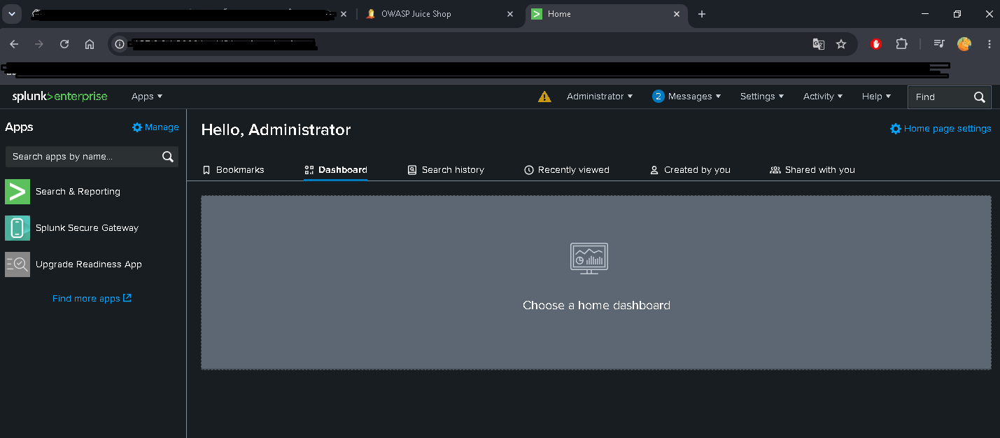
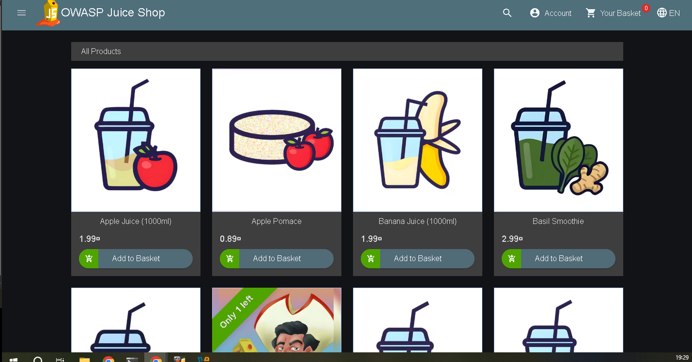
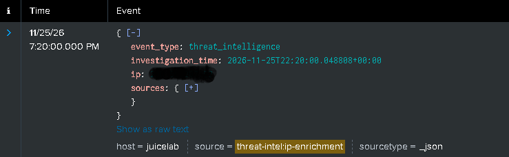

# SOC Lab — Security Operations Center

Laboratório prático de operações de segurança (SOC), desenvolvido para estudar monitoramento de eventos, análise de tráfego HTTP, integração de Threat Intelligence e utilização do Splunk Enterprise como SIEM.

O projeto utiliza uma aplicação OWASP Juice Shop para gerar eventos reais de acesso, que são coletados pelo Nginx, encaminhados ao Splunk e analisados por meio de consultas SPL e dashboards.

---

## Objetivos do projeto

- Implementar um ambiente de monitoramento utilizando Splunk Enterprise.
- Coletar e centralizar logs de uma aplicação web.
- Analisar requisições HTTP e identificar comportamentos potencialmente suspeitos.
- Integrar fontes externas de Threat Intelligence.
- Automatizar o enriquecimento de endereços IP.
- Desenvolver consultas SPL e dashboards para visualização dos eventos.

## Arquitetura do laboratório

O ambiente é composto por duas máquinas virtuais Ubuntu Server executadas no VirtualBox e conectadas por meio do Tailscale.

| Máquina | Responsabilidade |
|---|---|
| SOC-LAB-Ubuntu | Splunk Enterprise e centralização dos eventos |
| juicelab | OWASP Juice Shop, Docker, Nginx e scripts Python |

### Fluxo de funcionamento

1. A aplicação OWASP Juice Shop recebe as requisições HTTP.
2. O Nginx registra os acessos em formato JSON.
3. O script `forwarder.py` encaminha os eventos ao Splunk por meio do HTTP Event Collector (HEC).
4. O script `auto_threat_intel.py` monitora os acessos e identifica IPs públicos.
5. O script `threat_intel.py` consulta as APIs VirusTotal e AbuseIPDB.
6. O módulo `ti_cache.py` armazena os resultados em SQLite por 24 horas.
7. Os eventos e resultados são centralizados no Splunk para análise e visualização.

## Tecnologias utilizadas

| Tecnologia | Aplicação |
|---|---|
| Splunk Enterprise | SIEM e análise de eventos |
| OWASP Juice Shop | Aplicação web para geração de tráfego |
| Docker | Execução da aplicação |
| Nginx | Proxy reverso e coleta de logs HTTP |
| Python 3 | Automação e integração de eventos |
| SQLite | Armazenamento temporário de resultados |
| VirusTotal | Enriquecimento de Threat Intelligence |
| AbuseIPDB | Análise de reputação de IPs |
| Tailscale | Conectividade entre as máquinas virtuais |
| VirtualBox | Virtualização do laboratório |
| SPL | Consultas e análise de eventos no Splunk |

## Threat Intelligence

O laboratório possui integração com duas fontes de inteligência de ameaças:

**VirusTotal**
- Quantidade de detecções maliciosas.
- Resultados de análise de reputação.
- Indicadores retornados pela plataforma.

**AbuseIPDB**
- Pontuação de confiança de abuso.
- Quantidade de denúncias.
- País de origem e informações do provedor.

Os resultados são enviados ao Splunk para centralização e visualização.

O cache SQLite evita consultas repetidas durante o período de validade de 24 horas.

## Dashboards e monitoramento

O Splunk é utilizado para visualizar e analisar:

- Requisições HTTP.
- Endereços IP de origem.
- Métodos e códigos de resposta HTTP.
- Rotas acessadas na aplicação.
- Informações de geolocalização.
- Resultados de Threat Intelligence.
- Indicadores de atividades potencialmente suspeitas.

## Evidências visuais

### Splunk Enterprise



### Dashboard SOC


### OWASP Juice Shop



### Eventos HTTP


### Threat Intelligence



## Estrutura do repositório

```text
SOC-Lab-Security-Operations-Center/
│
├── README.md
│
├── consultas/
│   └── consultas-spl.md
│
├── scripts/
│   ├── README.md
│   ├── forwarder.py
│   ├── threat_intel.py
│   ├── auto_threat_intel.py
│   └── ti_cache.py
│
└── screenshots/
    ├── splunk-home.png
    ├── soc-dashboard.png
    ├── juice-shop.png
    ├── http-events.png
    └── threat-intelligence.png
```

## Segurança

Este laboratório foi desenvolvido em ambiente controlado para fins educacionais.

- Tokens HEC e chaves de API não devem ser publicados.
- Arquivos de configuração com credenciais devem permanecer fora do repositório.
- Bancos de dados locais não devem ser enviados ao GitHub.
- O Splunk não deve ser exposto diretamente à internet sem as proteções adequadas.

## Aprendizados

O desenvolvimento deste projeto permitiu praticar conceitos de:

- SIEM e centralização de logs.
- Monitoramento de aplicações web.
- Análise de eventos e tráfego HTTP.
- Consultas SPL.
- Integração de APIs.
- Threat Intelligence.
- Automação com Python.
- Enriquecimento e correlação de eventos de segurança.

---

**Projeto desenvolvido para fins de estudo e construção de portfólio em Segurança da Informação e operações SOC.**
